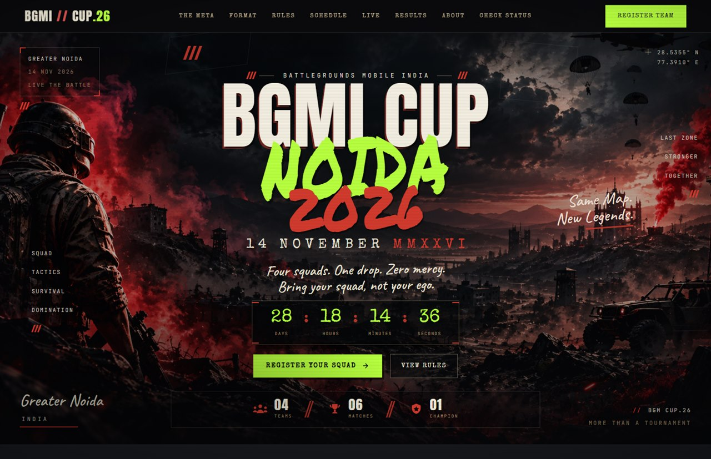
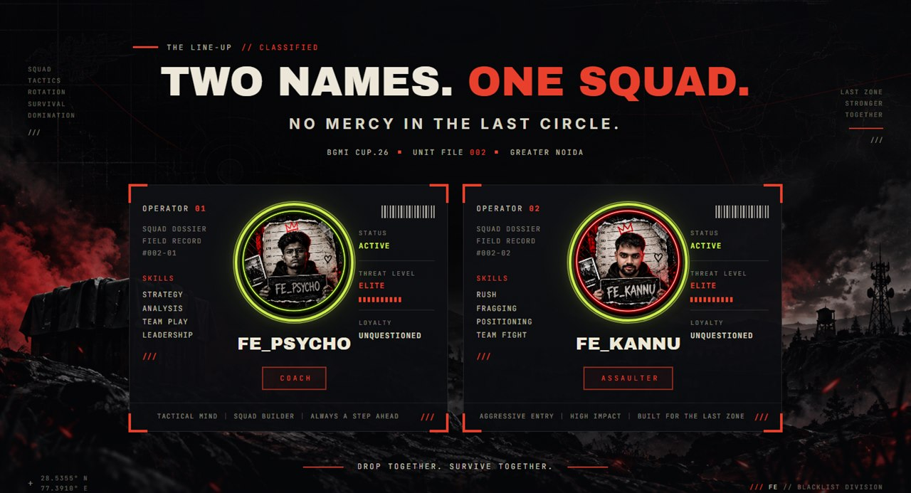
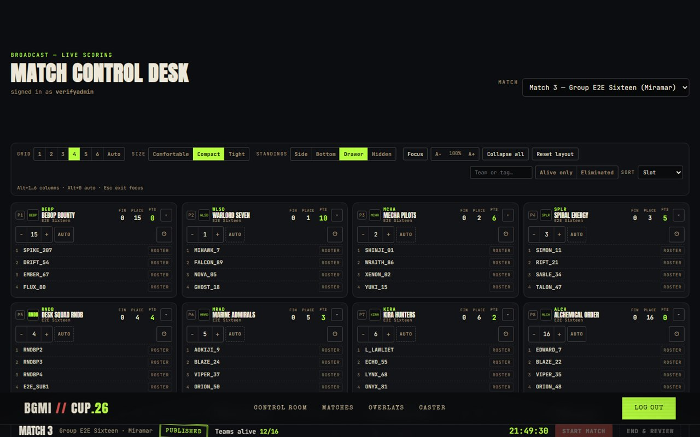
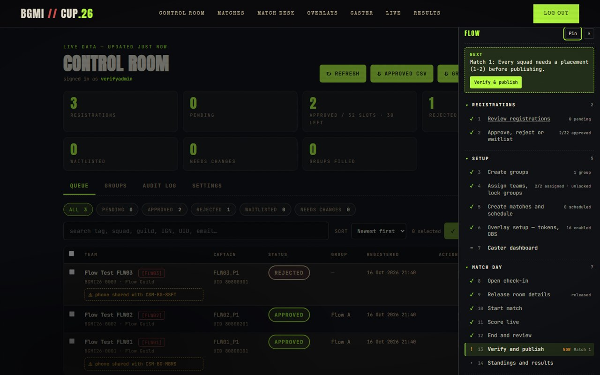
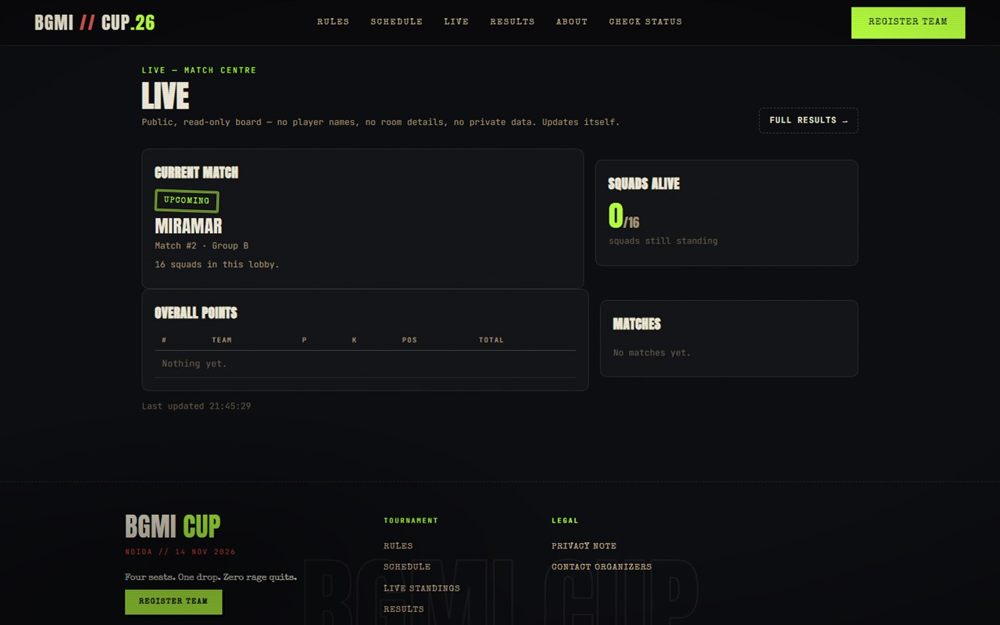
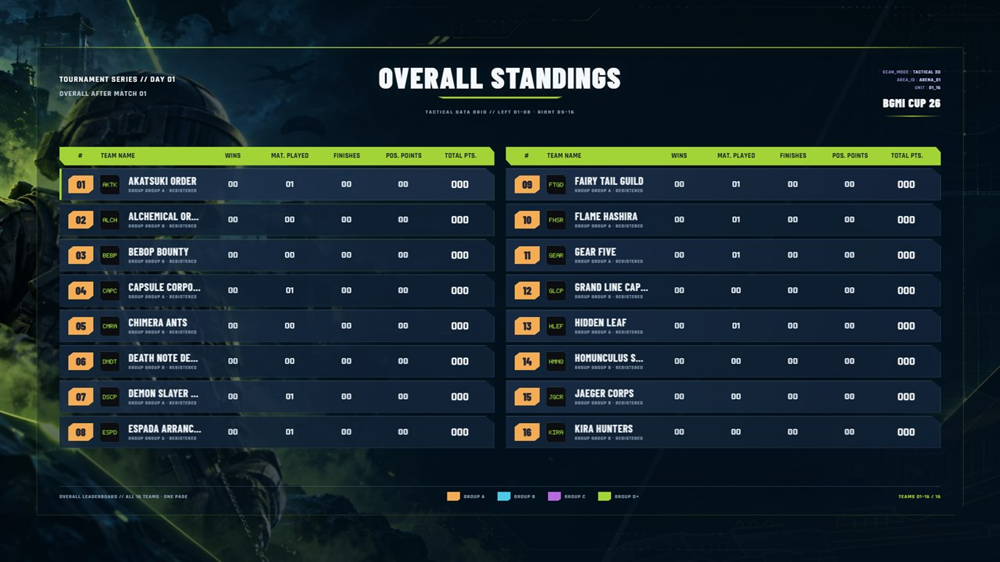

# BGMI CUP — Tournament Platform

**Four squads. One drop. Zero mercy.** — the tournament platform behind the
BGMI CUP community cups: currently powering **CUP.26** (Greater Noida ·
14 November 2026), and built to run every edition after it. One project, one
server, one database, one login, one theme, covering the whole event.


## Screenshots

| Public home — CUP.26 hero | About — the line-up dossier |
|---|---|
|  |  |
| Match Control Desk — live scoring | Admin FLOW workflow sidebar |
|  |  |
| Live match centre (SSE) | OBS broadcast overlay (1920×1080) |
|  |  |

## What's inside

1. **Registration** — public squad registration with review/confirmation,
   status lookup, approved-teams grid, schedule, and a full admin approval
   workflow (Control Room).
2. **Broadcast** — match schedule, live control desk (kills, damage, status,
   placements, undo), public live/results pages, 16 original OBS
   browser-source overlays, and a caster dashboard — all driven from the same
   approved teams and groups (the registration section is the single source
   of truth).

**Stack:** Python 3 standard library only — no pip packages, no build step,
one SQLite database (`data/registrations.db`). Minimum Python **3.7**
(`ThreadingHTTPServer`; verified on 3.10). Playwright + Chromium only for the
browser tests. Real-time updates use **Server-Sent Events** with a polling
fallback — no Socket.IO, no Node server (the original overlay pages
talk to a tiny bridge at `/socket.io/socket.io.js`).

## Layout

```
server.py            Static file server + JSON API + SQLite + SSE + notify worker
broadcast.py         Broadcast engine: schema/migrations, scoring, match
                     lifecycle, desk actions, undo, standings, overlay state
flow.py              FLOW workflow status — NEXT card + step states
public/              Web root
  *.html             Public pages (index, status, teams, schedule, live,
                     results, about, 404, privacy)
  admin*.html        Admin pages (dashboard, matches, control desk,
                     overlays producer, caster)
  overlay.html       Original broadcast overlay shell — /overlay/<scene>
  overlay.css/.js    Original overlay styles + 16 scene renderers (as-is)
  socket.io/         socket.io.js shim — bridges the overlays to SSE
  css/               style.css (theme), admin.css, admin-flow.css (FLOW
                     sidebar), control.css (desk), footer.css
  js/                nav.js, admin-shell.js (BC bootstrap), admin-flow.js
                     (shared FLOW component), per-page scripts
  assets/, images/   Vendor libs + imagery
scripts/             create_admin.py, seed_demo.py, backup_db.py,
                     restore_db.py, verify.bat / verify.sh
tests/               Python suites, Playwright specs, 11 e2e stages (tests/e2e)
docs/                api.md, features.md, security.md, testing.md, merge-plan.md
data/                Live data: registrations.db + uploads/ (gitignored)
backups/             backup_db.py output (gitignored)
```

## Install & run

There is nothing to install — Python 3 is the only requirement.

```powershell
# one-time: create the database schema (data/registrations.db)
python -c "import server; server.init_db()"

# one-time: create your admin account (prompts for username/password;
# no default account exists. Re-running with the same username resets it.)
python scripts/create_admin.py

# recommended: first backup
python scripts/backup_db.py

python server.py                       # http://127.0.0.1:8080
```

Change the bind with `HOST` / `PORT` (`$env:PORT='9000'; python server.py`).

## Route map

**Public** (no login):

| Route | Page |
|---|---|
| `/` | Registration |
| `/status` | Status lookup |
| `/teams` | Approved teams grid |
| `/schedule` | Schedule + group draw + match times |
| `/live` | Live match centre (SSE) |
| `/results` | Standings, group tables, match results |
| `/about` · `/privacy.html` · | Info pages |
| `/overlay/<scene>` | Original OBS overlay scene (token-gated data) |
| `/standings` · `/operator` · `/login` | Legacy redirects → `/results` · `/admin/control` · `/admin` |

**Admin** (one session + CSRF, gated server-side on every route):

| Route | Page |
|---|---|
| `/admin` | Registration approval dashboard |
| `/admin/matches` | Match schedule + start times + check-in + scoring rules |
| `/admin/control` | Match Control Desk (drive a live match) |
| `/admin/overlays` | Overlay producer (URLs, token, event logo, preview) |
| `/admin/caster` | Caster dashboard + push-stat-card |

**API:** registration/status endpoints (see [docs/api.md](docs/api.md)) plus
`/api/live/state`, `/api/live/stream` (SSE), `/api/overlay/state/<name>`,
`/api/overlay/stream/<name>` (token-gated), and `/api/admin/matches*`,
`/api/admin/matches/<id>/*`, `/api/admin/overlay-settings`,
`/api/admin/scoring-rules`.

## Broadcast in 60 seconds

1. Approve teams and draw groups in `/admin` (registration section is the
   source of truth — matches can only contain approved squads of a group).
2. `/admin/matches` → create a match for a group, check squads in (max 16).
3. `/admin/control` → **Start match**; each squad card takes finishes, kills,
   damage, player status and placement (type a number or use the stepper;
   **AUTO** hands the pin back to the engine). The gear has **Swap player**,
   **Manual adjustment** (reason required, audited; PTS = placement + finishes
   + adjustment) and **Reset team**. **Undo** reverses any logged action;
   keyboard: `S` start/end, `U` undo, `R` refresh, `ESC` close menus.
4. **Verify and publish** (gated: every squad needs a placement) — points
   flow into standings, `/live`, `/results` and the overlays immediately.
5. `/admin/overlays` → copy the 16 overlay URLs into OBS browser sources
   (1920×1080, transparent). Each URL carries a rotatable token.
6. `/admin/caster` → standings + push any player's stat card; the pushed
   card shows on the caster desk (the original overlay set has no card
   scene — see docs/merge-progress.md R2-2 for the missing-scene list).

Scoring: placement points `{1:10, 2:6, 3:5, 4:4, 5:3, 6:2, 7:1, 8:1}` (9th+ = 0)
+ 1 pt per finish, all tunable on `/admin/matches` — change the table and
every table (desk, `/live`, `/results`, overlays, CSV exports) follows it.
Tie-breakers apply in order after total points; default: wins (1st places) →
placement points → finish points → last-match placement (configurable, and
worth confirming against your event's rulebook). Exports:
`/api/admin/export/standings.csv` and `/api/admin/export/match/<id>.csv`.

Every admin page also carries the shared **FLOW** workflow sidebar — a NEXT
card plus phase-by-phase step states (registrations → setup → match day →
verify), pinnable on wide screens, a drawer on tablets and a bottom sheet on
phones.

## Tests

Everything runs against throwaway servers and temporary databases — the live
`data/registrations.db`, `.env` and the demo server are never touched.

```powershell
scripts\verify.bat        # Windows: the entire suite in one command
scripts/verify.sh         # macOS / Linux equivalent

python tests/test_api.py            # registration/public API suite
python tests/test_admin.py          # admin workflow suite (includes one 61s wait)
python tests/test_broadcast.py      # scoring engine + desk/overlay suite
python tests/test_flow.py           # admin FLOW workflow-status endpoint
python tests/test_seed.py           # demo-seed safety rails and scenarios
npx playwright test                 # browser specs (run `npm install` once first)
```

`verify.bat` chains the five Python suites, the Playwright browser specs and
11 end-to-end stages (`tests/e2e/`, a freshly seeded temp DB on port 8090)
that drive real workflows — registration, approval, schedules, the live desk
and publishing, overlays, scoring, security and accessibility — and exits
non-zero unless every stage is green. Coverage details:
[docs/testing.md](docs/testing.md).

## Seed demo data

```powershell
python scripts/seed_demo.py                    # 32 demo squads (16/16 in Group A+B) +
                                               # one scheduled match per group
python scripts/seed_demo.py --scenario mixed   # 20 approved + the other statuses in play
python scripts/seed_demo.py --with-results     # also play + publish one group opener
python scripts/seed_demo.py --db <path>        # alternate DB (else BGMI_DB_PATH / BGMI_DB)
python scripts/seed_demo.py --reset --yes      # wipe + reseed even if rows look real
```

The seed is safe to re-run: before anything is touched the database and uploads
are archived to a verified zip at `<db-dir>/backups/pre-reset-YYYYMMDD-HHMM.db`,
and if it finds rows that do not look like demo data (emails must end in
`@example.com` or the legacy `@demo.invalid`) a plain run stops without
changing anything — `--reset` is required and asks for a typed `RESET` unless
`--yes` is given. The 32 squads are inserted through the real registration path
(validated fields, generated roster and logo tiles), approved, split 16/16 into
Group A and Group B, and each group gets one scheduled match. Settings and
scoring rules are restored to their defaults except the slot limit (32); the
overlay token is rotated. `settings.demo_seed` lights the **DEMO DATA** badge in
the admin UI until a purge removes it.

## Environment variables

Variables are read from the process environment (PowerShell: `$env:PORT='9000'`,
cmd.exe: `set PORT=9000`). Every name is listed in
[.env.example](.env.example) — values never go into git. The broadcast
section adds no environment variables: the overlay token and producer
settings live in the database (`overlay_settings`).

| Variable | Default | Purpose |
|---|---|---|
| `HOST` / `PORT` | `127.0.0.1` / `8080` | Bind address |
| `BGMI_DB` | `data/registrations.db` | SQLite database path |
| `BGMI_UPLOADS` | `data/uploads` | Team-logo storage directory |
| `BGMI_SLOT_LIMIT` | `16` | Approved-slot limit |
| `BGMI_RATE_LIMIT` / `BGMI_RATE_WINDOW` | `30` / `3600` | Register POSTs per IP per window (seconds) |
| `BGMI_STATUS_RATE_LIMIT` / `BGMI_STATUS_RATE_WINDOW` | `5` / `60` | Status lookups per IP per window (seconds) |
| `BGMI_SESSION_TTL` / `BGMI_SESSION_IDLE_TTL` | `1209600` / `28800` | Admin session absolute cap / idle timeout (seconds) |
| `BGMI_SMTP_HOST` / `BGMI_SMTP_PORT` / `BGMI_SMTP_USER` / `BGMI_SMTP_PASS` / `BGMI_SMTP_FROM` | *(unset)* / `587` | Optional e-mail; SMTP unset → jobs are marked *skipped* |
| `BGMI_NOTIFY_ATTEMPTS` / `BGMI_NOTIFY_POLL` | `5` / `30` | Send attempts before *failed* / worker tick (seconds) |
| `BGMI_ADMIN_USER` / `BGMI_ADMIN_PASSWORD` | — | Non-interactive input for `scripts/create_admin.py` |
| `BASE` / `BGMI_RATE_LIMIT_TEST` | *(tests)* | Point a suite at a running server / enable the rate-limit probe |

No secrets live in the code: admin credentials come only from
`scripts/create_admin.py`, SMTP credentials only from environment variables,
the overlay token is generated into the database and rotatable from
`/admin/overlays`.

## OBS setup (overlays)

1. In OBS add a **Browser** source per overlay you want.
2. URL: copy from `/admin/overlays` (each contains `?token=…`); width
   `1920`, height `1080`; leave "Shutdown source when not visible" off so
   SSE reconnects cleanly.
3. Backgrounds are transparent — safe to stack. Load the `hidden` scene on
   any source to blank it.
4. Rotating the token on `/admin/overlays` invalidates every copied URL at
   once — paste the new URLs into OBS after rotating.

## Backup & restore

```powershell
python scripts/backup_db.py                     # -> backups/registrations-<stamp>.db
python scripts/restore_db.py backups/<file>     # stop the server first
```

SQLite's online backup API + integrity check; atomic restore with an
`--overwrite` guard. Details: [docs/features.md](docs/features.md).

## Docs

- [docs/api.md](docs/api.md) — HTTP API reference
- [docs/features.md](docs/features.md) — approval workflow, broadcast feature guide, file map
- [docs/security.md](docs/security.md) — sessions, throttling, headers, privacy, overlay tokens
- [docs/testing.md](docs/testing.md) — suite coverage & isolation
- [docs/merge-plan.md](docs/merge-plan.md) — how the registration and broadcast sections were merged
