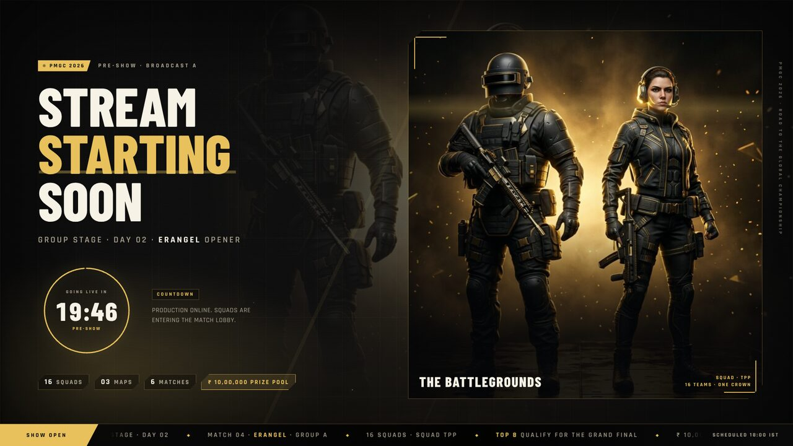
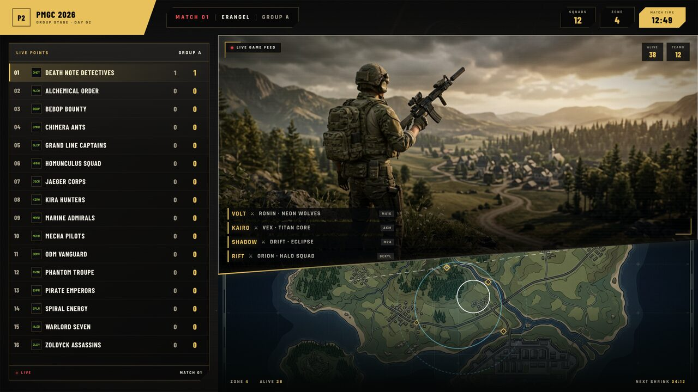
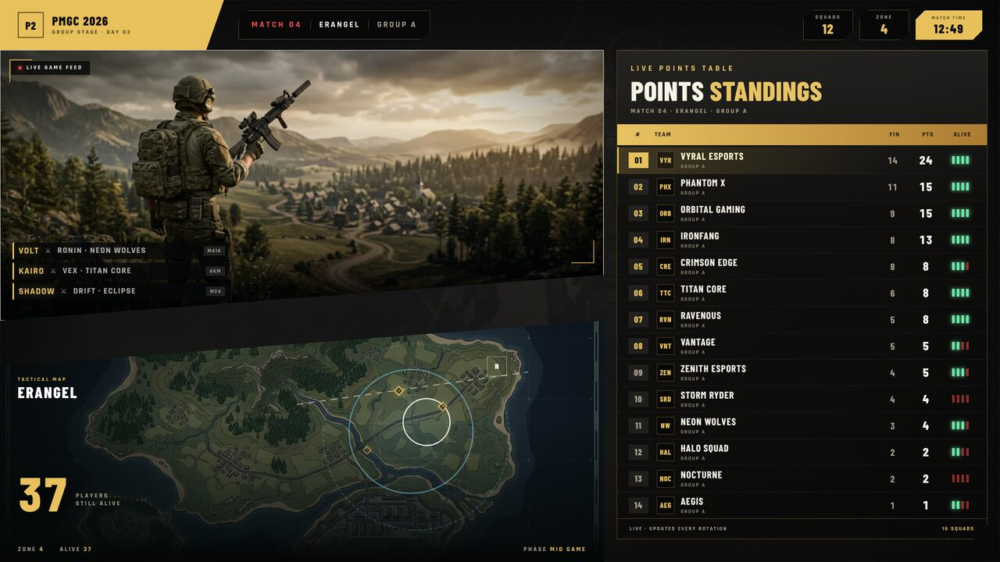
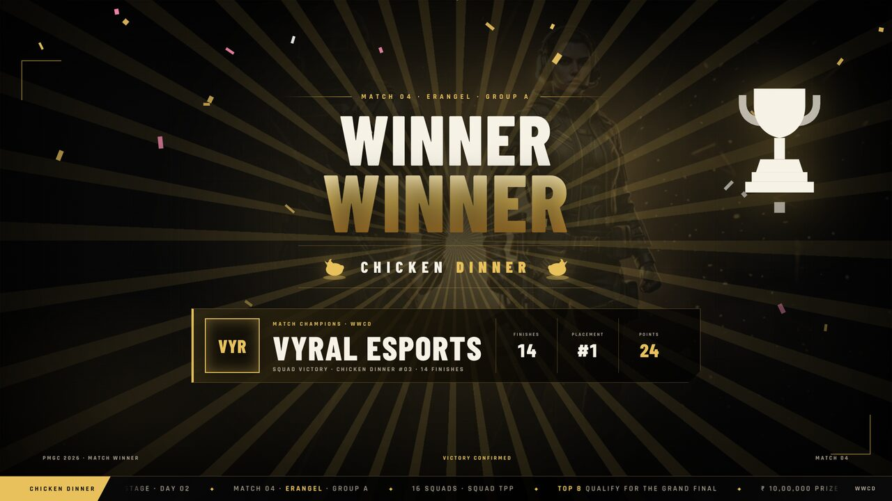
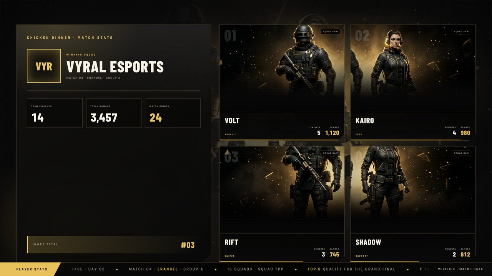
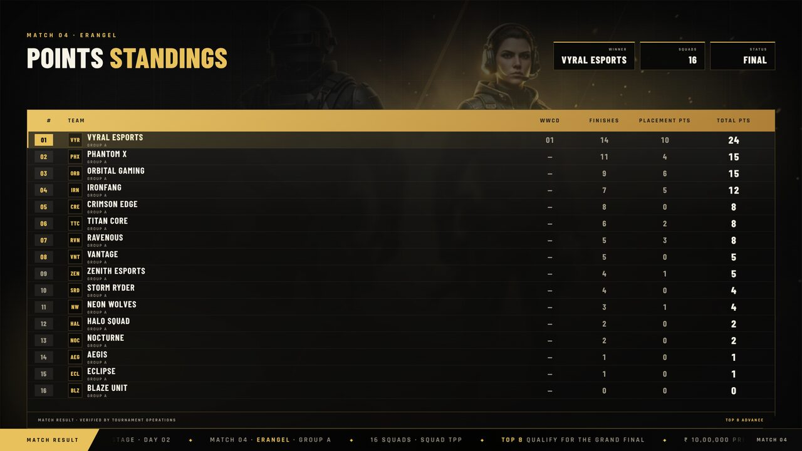
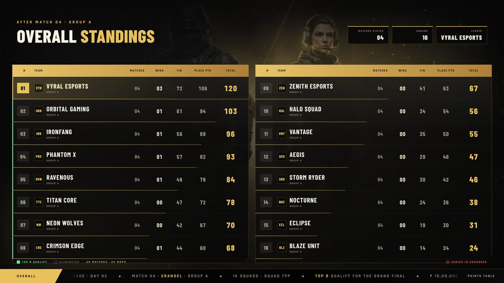
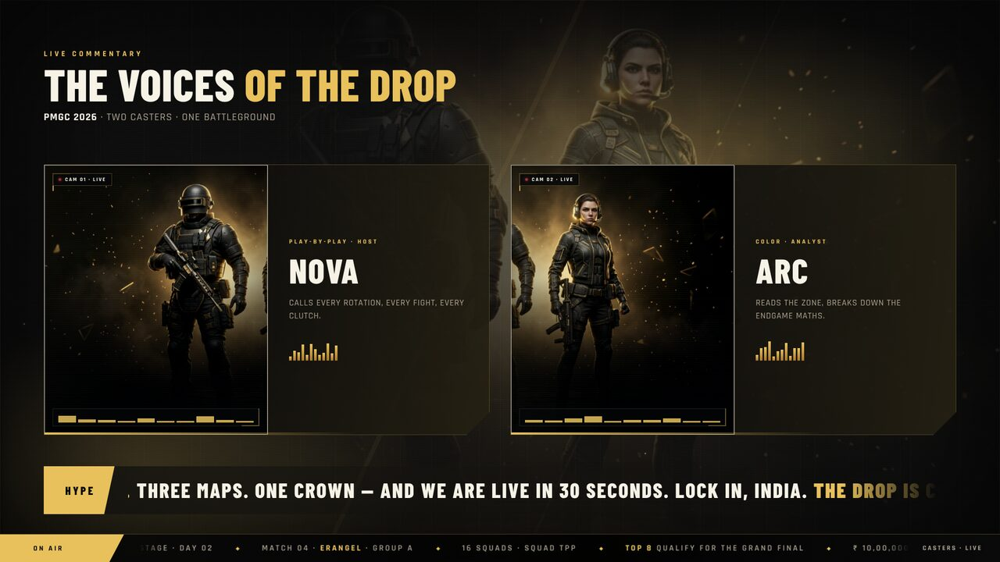
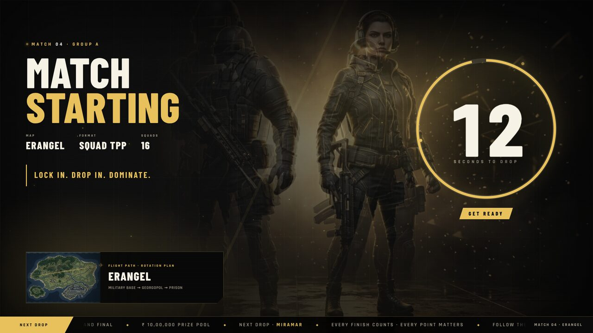
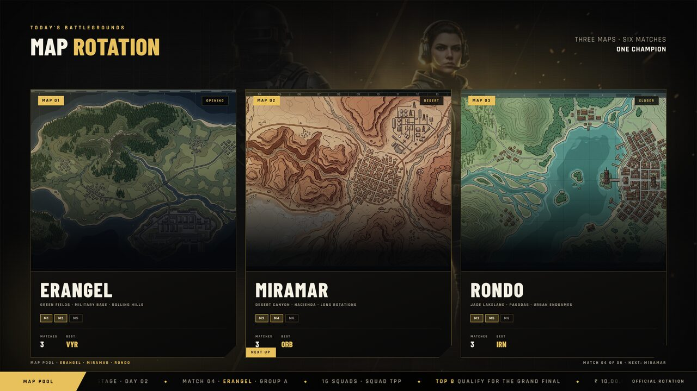

# PMGC 2026 broadcast stage

A ten-theme, ten-scene tournament rundown for OBS, built for this platform.
The colour language, panel geometry, type treatment and motion are an original
interpretation of modern battle-royale esports broadcast design (the
KRAFTON India Esports / PMGC school: black-and-gold championship grades,
high-contrast accents, slashed panels, heavy condensed type, diagonal feeds).
No official KRAFTON logo, game artwork or character asset is bundled — the
key art and the three map plates in `public/assets/images/pmgc/` were produced
for this project.

| URL | What it is |
|---|---|
| `/pmgc` | Theme gallery + rundown index (pick a theme, open any scene) |
| `/pmgc/<scene>?theme=<id>` | The 1920×1080 stage on that scene and theme |
| `/admin/overlays` | Producer card: pick theme + scene, live preview, copy the OBS URL |

## The rundown

| # | Scene id | On screen |
|---|---|---|
| 01 | `opening` | **Stream starting soon** — event art, ring countdown (`?start=` seconds, default 1200), phase label, squads/maps/matches chips |
| 02 | `casters` | **Caster intro** — two camera plates, names, roles, tags, equaliser, scrolling hype line |
| 03 | `drop` | **Match drop** — 30-second ring clock, `GET READY → STAND BY → DROP NOW`, caster hype lines, flight-path map card |
| 04 | `live` | **Live + map (diagonal)** — gameplay feed above a raked seam, tactical map below, live-points rail, elimination feed, score bug |
| 05 | `live-points` | **Live game feed + live points standings** — feed with the map tucked underneath, 16-row live points table |
| 06 | `chicken-dinner` | **Winner winner chicken dinner** — sunburst, confetti, slam-in type, trophy, winning squad strip |
| 07 | `winner-stats` | **Chicken dinner stats** — team totals plus four player cards (finishes, damage) |
| 08 | `match-standings` | **Match points** — 16-row result table (WWCD, finishes, placement points, total) |
| 09 | `overall` | **Overall standings** — two tables, 01–08 left and 09–16 right; each row carries matches played, wins, finishes, placement points and total, plus the qualification legend |
| 10 | `map-rotation` | **Map rotation** — Erangel · Miramar · Rondo cards with match slots and best squad |

| Live + diagonal map | Live points |
|---|---|
|  |  |

| Chicken dinner | Winner stats |
|---|---|
|  |  |

| Match points | Overall standings |
|---|---|
|  |  |

"Play full show" walks the rundown in order (22s → 15s → 12s → 24s → 20s →
15s → 16s → 18s → 20s → 18s) and the drop scene hands over to `live`
automatically once its clock hits zero.

## The ten themes

| id | Identity |
|---|---|
| `krafton-gold` | Championship black + antique gold, gold grid, embers |
| `pmgc-neon` | Cyan/magenta circuit grid, scanlines, chromatic flicker |
| `red-zone` | Crimson alert, hazard stripes, siren vignette pulse |
| `miramar-sand` | Desert ochre, topographic survey rings, heat shimmer |
| `rondo-jade` | Jade + ink, drifting lantern glow |
| `vikendi-frost` | Glacier blue, frosted glass panels, falling snow |
| `livid-magenta` | Hot magenta/violet, brutalist offset shadows, pop blobs |
| `blackout-hud` | Matte black, hairline rules, lime telemetry sweep |
| `royal-chrome` | Navy + polished chrome text, travelling sheen |
| `sunset-victory` | Sunset gradient, sunburst rotation, warm celebration |

Themes are pure token blocks: `public/css/pmgc-themes.css` defines
`--p-accent`, `--p-bg`, `--p-panel`, `--p-cut`, `--p-radius`, the three
pre-mixed accents (`--p-accent-12/20/30`) and a motif layer per theme.
`public/css/pmgc-stage.css` only ever reads those tokens, so a new identity is
one copy of a token block plus a motif rule and an entry in the picker lists
(`THEMES` in `public/js/pmgc-stage.js`, the gallery script and the producer
card in `public/js/overlays.js`).

Everything is plain CSS + vanilla JS — no build step, no dependencies.

## OBS setup

1. Add a **Browser source**: `http://<host>/pmgc/<scene>?theme=<id>&ui=0`
   - width **1920**, height **1080**, FPS **30**
   - custom CSS empty, "Shutdown source when not visible" **off**
2. `ui=0` hides the operator bar, `obs=1` also makes the canvas transparent so
   the overlay can sit over a gameplay capture.
3. For the diagonal split scenes, put the real gameplay capture under the
   browser source, or pass `?feed=<image or video-still URL>` to use your own
   feed inside the frame. `?map=<url>` overrides the tactical map plate.
4. One URL per scene is often easiest to switch in OBS. Alternatively keep a
   single tab and use the round keys.

### URL options

| Param | Effect |
|---|---|
| `scene=<id>` | Pin the scene (same as `/pmgc/<id>`) |
| `theme=<id>` | Pin the theme |
| `ui=0` | Hide the operator bar |
| `obs=1` | Transparent body + no UI |
| `auto=1` | Start the full show immediately |
| `start=<seconds>` | Stream-start countdown length (default 1200) |
| `feed=<url>` | Your own gameplay image/still inside the feed window |
| `map=<url>` | Your own tactical map plate |
| `demo=0` | Ignore the built-in showcase roster even when no live data exists |

### Operator keys (stage tab)

`←` / `→` previous / next scene · `1`–`9`, `0` jump to scene ·
`space` play/pause the full show · `R` replay the current scene animation ·
`F` fullscreen · `H` hide the operator bar.

## Data

The stage polls `/api/live/state` on load and then follows `/api/live/stream`
(SSE) — every event triggers one fresh state read. When the tournament
database has at least four squads the real team names, logos, wins, finishes,
placement points and totals replace the built-in showcase roster; otherwise
the showcase roster (and its simulated eliminations between scene entry and
exit) keeps the graphics populated. No player UID, phone or e-mail is ever in
the payload, and the stage renders every string through `textContent`.

| Casters | Match drop |
|---|---|
|  |  |

## Files

| Path | Purpose |
|---|---|
| `public/pmgc.html` | Gallery / rundown index |
| `public/pmgc-stage.html` | The ten-scene stage markup |
| `public/js/pmgc-stage.js` | Scene controller, countdowns, live data, theme engine |
| `public/js/pmgc-gallery.js` | Gallery cards + rundown list (external: CSP has no inline scripts) |
| `public/css/pmgc-themes.css` | Ten theme token blocks, motif layers, per-theme component dressing |
| `public/css/pmgc-stage.css` | Stage layout, all scenes, shared broadcast components, animation |
| `public/assets/images/pmgc/` | Original key art, gameplay still and the three map plates |
| `public/js/overlays.js`, `public/admin-overlays.html` | Producer card on `/admin/overlays` |
| `tests/pmgc-stage.spec.js` | Playwright suite (routing, themes, countdowns, tables, keys) |
| `server.py` | `/pmgc` and `/pmgc/<scene>` routes |

## Accessibility & performance

- `prefers-reduced-motion: reduce` stops the motif layers, confetti and scene
  fill animations.
- The 1920×1080 canvas is scaled with a single CSS transform, so the whole
  stage is one composited layer — no per-frame layout work.
- Fonts are self-hosted (`/assets/fonts/`), images are static JPEGs, and the
  only network traffic is one state read plus SSE.

## Event-layout / OBS update

The ten generic names have been replaced by `bmps-2024`, `bgms-2024`,
`bgis-2025`, `bgis-2026`, `bmsd-2025`, `bmsd-2026`, `bmic-2025`,
`pmgc-2025`, `ewc-2025`, `ewc-2026`. The earlier IDs remain URL aliases.
Catalog: `public/js/broadcast-themes.js`; consumers share this single list.
Layouts: `public/css/pmgc-layouts.css`. These are original event-inspired
adaptations, not official CG packages; see `docs/broadcast-references.md`.

The rundown now has eleven scenes: `map-intro` is inserted after `drop`.
The drop clock expires after the real 30 seconds even in manual mode, then
plays the 8-second selected-map bumper and moves to `live`. Auto-show does
not skip either the configured opening clock or the match-drop clock.
Music is original CC0 (`audio=0` to mute; OBS controls browser audio).

New parameters: `battleground=erangel|miramar|rondo`, `sponsor=<text>`,
`event=<text>`, `caster1=<text>`, `caster2=<text>`, `guides=1` (interactive
source-coordinate guide only). Use `obs=1` for production URLs.

Camera scenes, match-drop cameras and gameplay are transparent. Live+map
has no standings, game lower-left / map upper-right, match/event upper-left
and sponsor lower-right. Mask assets in `public/assets/obs/` must be applied
to the independent video sources in OBS; CSS cannot crop other sources.
Live points has a fully opaque right-side board, 15-character names, and
accurate player status pips (white alive/red knocked/grey eliminated).
Showcase simulation is disabled whenever real tournament state is loaded.

Full user-facing instructions are served at `/broadcast-setup.html`.
The original `/overlay` shell remains untouched.

## Rectangular live + map correction

The operator confirmed gameplay **bottom-right**, not bottom-left. `/pmgc/live`
now uses separate transparent rectangular frames with no diagonal cut:
map `(1304,80,576,324)`, gameplay `(792,428,1088,612)` at 1920×1080.
No standings in this scene. Event/match remains upper-left; sponsor is below
gameplay at bottom-right. Remove old OBS diagonal mask filters.
This supersedes the older diagonal instructions above.

## Latest placement correction

Gameplay rectangle is **bottom-left** at `(40,428,1088,612)`. Map remains
**top-right** at `(1304,80,576,324)`. This supersedes the prior bottom-right
gameplay placement. Both are transparent rectangles; no diagonal masks.
Sponsor stays bottom-right; event/match remains upper-left.

Map frame enlarged to `(1240,80,640,440)` (was 576×324). Right edge
stays at 1880. Gameplay remains `(40,428,1088,612)` with no overlap.
The map source may need cropping to fit its taller aspect ratio in OBS.

Live Points is now standings-only: the top event/match/squads/zone/time HUD
and gameplay-frame decorations are hidden in this scene. The standings
board and its player-status legend remain; the Live + Map HUD is unchanged.

Live Points is anchored 24px from the bottom/right. Its narrower team
column uses short tags. MP shows the squad's overall matches played; FIN
and TOTAL remain current-match values. Larger status pips are centered in
the status cell, vertically aligned to each row.

Match Points (`/pmgc/match-standings`) now uses two equal centered tables,
ranks 01–08 / 09–16, with repeated column headers and larger 76px rows.
The compact Live Points overlay and Overall layouts are unchanged.

## Producer Stream Starting timer

In `/admin/overlays`, use **Stream Starting timer (minutes:seconds)** and
**Apply / restart timer**. `5:30` means five minutes and thirty seconds.
Accepts `0:01` through `999:59`; seconds must be two digits from `00` to `59`.
The duration is persisted on the server, not just in the admin browser.
Applying it emits a live update and restarts open opening scenes; if SSE is
interrupted, the 15-second polling fallback catches the change. Other scenes
are not interrupted and use the saved duration next time opening is entered.
The preview and normal producer-generated OBS URLs require no manual editing.
Legacy explicit `start=` links retain their URL override; use the producer's
normal URL if you want the server-saved duration to control that source.

## MVP and top-five player scenes

The rundown now has **13 scenes**. In the producer's Scene picker choose
**11 · Match MVP** (`/pmgc/mvp`) or **12 · Top 5 players**
(`/pmgc/top-players`). Both support all ten selected event themes.

`/api/live/state.playerAwards.matchMvp` is the current match scoring leader
(finishes, then damage); `.topPlayers` is the tournament top five, including
live results. The latter uses UID-based server aggregation without exposing
UIDs publicly. This is **not** Krafton's proprietary MVP rating formula.
Displayed metrics: MVP finishes/damage; top five finishes/damage/matches.
Untracked knocks, survival, contribution and official MVP ratings are omitted.
Missing MVP data produces a waiting slate; fewer than five players produce
pending rows, never fake players. New scenes do not depend on the four-team
minimum used by the old showcase adapter. Updates arrive through the existing
public SSE/refetch flow plus 15-second polling fallback.

Design: hero spotlight with a stat panel for MVP; one featured leader and four
chaser rows for top five. Team logo/name, player IGN and neutral jersey/
monogram placeholder are supported. Player photo upload is not added here;
current scoring has no player portrait field. Reference survey and limits are
recorded in `docs/broadcast-references.md`.
